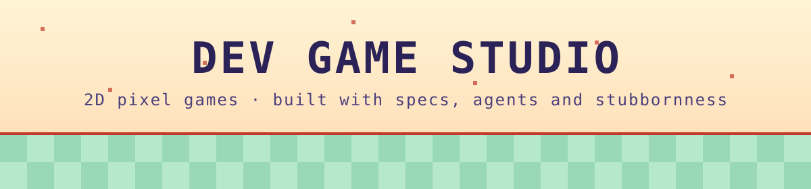

<picture>
  <source media="(prefers-color-scheme: dark)" srcset="assets/banner-dark.svg">
  
</picture>

# Dev Game Studio

**We make 2D pixel games, from the first tile to the last patch.**

*Based in Brazil · retro at heart · spec-driven by habit*

---

## Currently building

An **open-world 2D online RPG** with turn-based tactical battles. It is a non-commercial passion project that revives a classic game from legacy archives.

| Layer | What it is |
|---|---|
| **Client** | Godot 4, typed GDScript, pixel-perfect 2D |
| **Server** | Authoritative Java 25 server, Maven, PostgreSQL |
| **Contract** | Versioned client↔server protocol, validated on both sides |
| **Process** | Spec-driven development: every feature starts as a written spec |

## How we work

- **Specs first.** Features, requirements and decisions are written down before code.
- **AI-assisted, human-owned.** Coding agents implement from issues; every pull request is reviewed against the spec.
- **Automated review loop.** Batches of work are gated by tests and visual evidence.
- **Legacy archaeology.** We recover and document old game data instead of guessing.

## Tech we use

## Status

Our repositories are private for now. When something is ready to play, it will show up here first.

Made with care in Brazil 🇧🇷 · Pixels are original art

